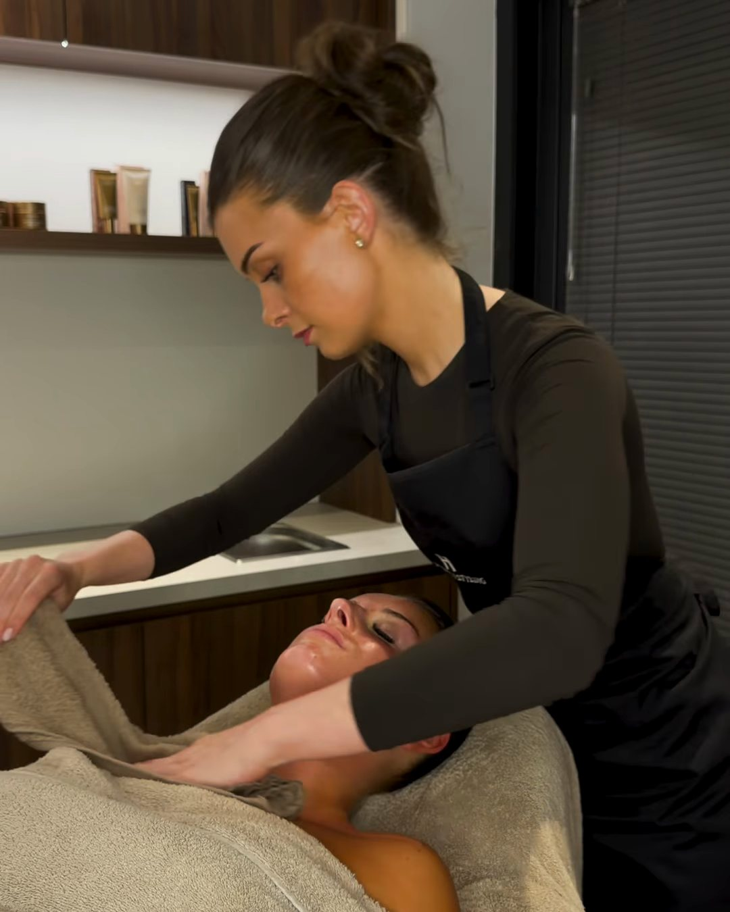

# De Haas Styling

Website van **De Haas Styling**, de salon van Bibi de Haas in Empel ('s-Hertogenbosch): huidspecialist, pedicure specialist en nagelstylist.

**Live:** https://julian08100.github.io/dehaasstyling/



## Over de website

Een snelle, statische one-pager in de stijl van [@dehaasstyling](https://www.instagram.com/dehaasstyling/) op Instagram: warm crème, taupe en espresso, serif-typografie en glazen kaartjes. Alle teksten, foto's en video's komen van Bibi zelf.

De pagina volgt het **AIDA-model**:

| Fase | Onderdeel |
|---|---|
| **Attention** | Hero met video uit de salon, kernbelofte en "−50% op je eerste behandeling" |
| **Interest** | "Herken je dit?" (vier huidbehoeften), behandelingen met prijzen en het Organic Treat-ritueel |
| **Desire** | Echte resultaten (BIAB, Superlash voor/na), klantreacties, het verhaal van Bibi, producten en de salon |
| **Action** | Ingebouwde online agenda (MijnSalon), vaste afspraakknop op mobiel, FAQ en contact |

### Functies
- Elke "Afspraak maken"-knop opent de online agenda (MijnSalon) als stijlvolle pop-up, met een knop "Open in nieuw venster"; op mobiel als schuifpaneel van onderen
- Volledig responsive, met een vaste knop "Afspraak maken" op mobiel
- Geen cookies, geen tracking. Lettertypes worden zelf gehost (Cormorant Garamond en Jost, SIL OFL)
- Lazy-loaded video's die alleen afspelen als ze in beeld zijn, en ondersteuning voor `prefers-reduced-motion`
- SEO: meta- en Open Graph-tags en schema.org `BeautySalon`
- [Privacyverklaring](privacy.html)

## Structuur

```
index.html          De website
privacy.html        Privacyverklaring
assets/
  img/              Foto's (webp + jpg)
  video/            Korte, stille video-loops (H.264)
  fonts/            Zelf gehoste webfonts
  fonts.css
bron/               Originele beelden en tekst van Instagram
prepare_assets.py   Maakt assets/ opnieuw aan uit bron/ (vereist ffmpeg + Pillow)
```

## Lokaal bekijken

```bash
python3 -m http.server 8000
# open http://localhost:8000
```

## Publiceren

De site draait op GitHub Pages vanaf de `main`-branch. Elke push naar `main` publiceert automatisch. Voor een eigen domein: zet een `CNAME`-bestand met het domein in de root en wijs het domein in DNS naar GitHub Pages.

## Contact

De Haas Styling · Pottenbakker 27, 5236 AL 's-Hertogenbosch · KVK 98882732
[info@dehaasstyling.nl](mailto:info@dehaasstyling.nl) · 06 10 62 42 70 · [Instagram](https://www.instagram.com/dehaasstyling/) · [Afspraak maken](https://dehaasstyling.mijnsalon.nl)

© 2026 De Haas Styling. Alle foto's, video's en teksten zijn eigendom van De Haas Styling.
